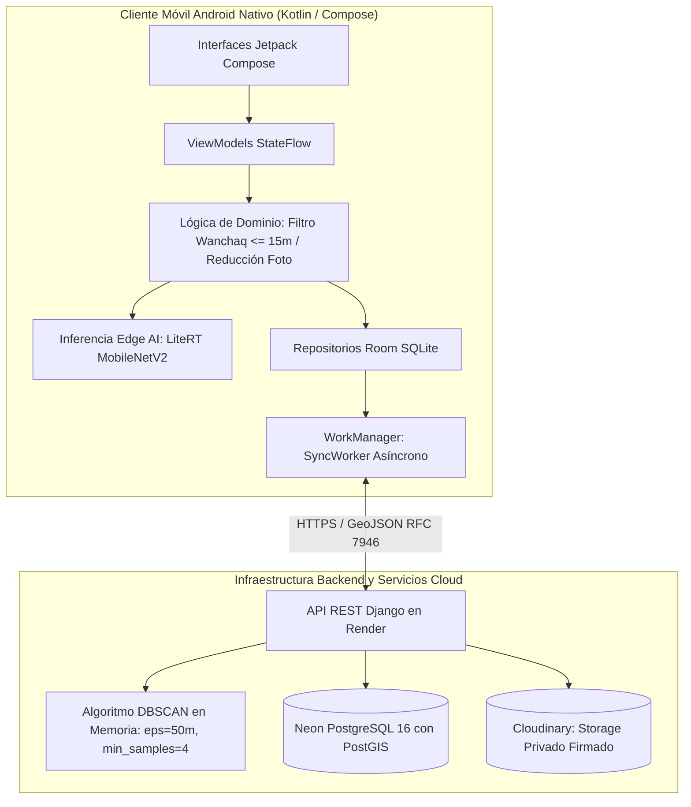

# Subsanación y Actualización — Capítulo IV: Sección de Desarrollo e Implementación del Sistema

> **Documento de destino**: `Proyecto de Investigación v5.91 (1) (1).docx`  
> **Sección a incorporar**: Capítulo IV (Sección 4.5 posterior al diseño de base de datos; enlaza el diseño teórico con la evidencia del software real).  
> **Estado**: Listo para copiar y pegar directamente en el documento de tesis Word.  
> **Fundamentación técnica**: Código fuente en `app/`, `backend/`, `ml/`, y suites de prueba en [`docs/pruebas.md`](../pruebas.md) y [`docs/distribucion-apk.md`](../distribucion-apk.md).

---

## CONTEXTO METODOLÓGICO PARA LA TESIS

En una tesis de Ingeniería de Sistemas e Informática, el Capítulo IV (*Presentación de Resultados*) no debe limitarse únicamente al diseño conceptual (diagramas y tablas). Debe demostrar de manera contundente la **materialización tecnológica del artefacto** resultante del proceso de investigación aplicada.

Esta sección documenta:
1. La construcción e integración del cliente móvil nativo Android en Kotlin con Jetpack Compose.
2. La integración del modelo de visión artificial en el dispositivo (Edge AI con MobileNetV2 y LiteRT).
3. La implementación de la resiliencia offline-first con Room y WorkManager.
4. El backend en Python/Django REST Framework y el algoritmo de agrupamiento DBSCAN en tiempo real.
5. La gestión de seguridad e infraestructura en la nube (Neon PostgreSQL y Cloudinary).
6. Los procedimientos de empaquetado, firma de APKs y aseguramiento de la calidad del código.

---

# TEXTO DEFINITIVO PARA EL DOCUMENTO WORD

---

## 4.5 Desarrollo e implementación del sistema

La fase de desarrollo consistió en la materialización del sistema informático conforme al marco ágil Scrum y los patrones arquitectónicos formalizados en la fase de diseño. A continuación, se detalla la implementación de cada uno de los componentes de software desarrollados en el cliente móvil, en el modelo de inteligencia artificial y en la infraestructura backend desplegada en la nube.

**Ilustración 7**  
*Mapeo de componentes implementados en el ecosistema tecnológico*

---

### 4.5.1 Entorno de desarrollo y control de versiones
La construcción del software se gestionó bajo un repositorio unificado administrado mediante el sistema de control de versiones distribuido **Git**, estructurado en tres componentes de ingeniería independientes:
* `/app`: Proyecto de cliente móvil nativo desarrollado en Android Studio (Koala/Ladybug Feature Drop) con Gradle 9.4 y Kotlin 1.9.24 sobre Java Development Kit (JDK 17).
* `/backend`: Aplicación de servidor desarrollada en Python 3.12 bajo el framework Django 5.1 y Django REST Framework 3.15, gestionada con entornos virtuales aislados.
* `/ml`: Tubería de experimentación, calibración y conversión de modelos de visión artificial en formato TensorFlow Lite / LiteRT.

---

### 4.5.2 Implementación del cliente móvil nativo Android

El desarrollo del aplicativo móvil se estructuró en seis módulos funcionales desacoplados bajo el patrón arquitectónico MVVM (Model-View-ViewModel):

#### Módulo 1: Onboarding y Consentimiento Informado (Ley N.º 29733)
Para dar cumplimiento estricto a los principios de consentimiento previo, informado, expreso e inequívoco de la Ley N.º 29733, se implementó el componente `OnboardingScreen`. El botón de acción permanece inhabilitado mediante reactividad en Compose hasta que el ciudadano activa la casilla de verificación. Al presionar el botón, el repositorio `ConsentimientoRepositoryImpl` genera un identificador único universal pseudoaleatorio versión 4 (`UUID.randomUUID()`) y lo persiste de forma segura en `DataStore Preferences` junto con la marca temporal. Este identificador anónimo actuará en adelante como firma del dispositivo para el filtrado de duplicados y seguimiento de envíos, prescindiendo totalmente de formularios de registro o autenticación con DNI.

#### Módulo 2: Captura fotográfica y georreferenciación en caliente
La captura de evidencia se implementó mediante la biblioteca **CameraX** vinculada al ciclo de vida del composable `ReporteScreen`. Para solucionar el retardo habitual del encendido del sensor satelital en entornos urbanos, se diseñó la estrategia de **precalentamiento de GPS**:
* Al abrir la cámara, el servicio `RastreadorDeUbicacion` activa el cliente satelital de Google Play Services (`FusedLocationProviderClient`) solicitando actualizaciones de alta prioridad (`PRIORITY_HIGH_ACCURACY`).
* La interfaz expone un indicador dinámico en tiempo real (`IndicadorGps`) que refleja tres estados: *Buscando satélites*, *GPS listo (±X m)* si la precisión es $\le 15\text{ m}$, o *Señal imprecisa* si excede el margen de error.
* El caso de uso `ValidarNuevoReporte` comprueba simultáneamente que las coordenadas pertenezcan al polígono administrativo de Wanchaq y que no exista un reporte previo emitido por el mismo dispositivo a menos de 20 metros y en menos de 30 minutos (filtro anti-duplicados).

#### Módulo 3: Motor de clasificación Edge AI en el dispositivo
Para categorizar el residuo fotografiado sin consumir datos móviles ni depender de conexión a Internet, se integró el clasificador en el cliente mediante **LiteRT** (el motor de ejecución optimizado de Google para modelos de inteligencia artificial en dispositivos móviles):
* La imagen capturada en alta resolución se reescala en memoria a dimensiones de $224 \times 224$ píxeles preservando la orientación EXIF real proporcionada por el sensor.
* El preprocesador `PreprocesadorImagen` extrae los canales RGB normalizados en un `ByteBuffer` directo de $1 \times 224 \times 224 \times 3 \times 4$ bytes.
* El modelo convolucional `MobileNetV2` cuantizado en punto flotante de 16 bits (FP16), empaquetado en los activos del proyecto (`assets/clasificador/clasificador_residuos.tflite`), ejecuta la inferencia en aproximadamente 45 milisegundos.
* La clase `InterpretarSalida` evalúa las probabilidades calculadas mediante softmax; si la probabilidad máxima supera el umbral de confianza calibrado ($\tau = 0.70$), sugiere la categoría detectada (`PLASTICO`, `CARTON`, `VIDRIO`, `ORGANICO`). Si la confianza es inferior al umbral, el sistema no fuerza una predicción y preselecciona la categoría `MIXTO`, permitiendo siempre que el ciudadano confirme o rectifique manualmente su elección en la pantalla de confirmación.

#### Módulo 4: Persistencia local y sincronización diferida (Offline-first)
Para asegurar que ningún dato se pierda por problemas de cobertura o cortes de red en la vía pública, se implementó la arquitectura *Offline-first*:
* **Persistencia Inmediata**: Al pulsar «Guardar reporte», la entidad `ReporteEntity` se inserta instantáneamente en la base de datos local **Room** con estado `PENDIENTE`.
* **Reducción de Imagen en Disco**: El módulo `ReductorDeFotosEnDisco` redimensiona la fotografía original reemplazándola por una versión reducida de máximo 1600 píxeles en su lado mayor y comprime el archivo en formato JPEG con calidad 80 (reduciendo el peso de ~4.5 MB a menos de 250 KB), eliminando simultáneamente metadatos EXIF privados.
* **Planificación Asíncrona con WorkManager**: El componente `ProgramadorSincronizacion` encola un trabajo diferido único con encadenamiento `APPEND_OR_REPLACE` restringido a red validada (`NetworkType.CONNECTED`). Al detectar conectividad real (verificada por `MonitorDeRedAndroid` mediante comprobación de capacidades `NET_CAPABILITY_VALIDATED`), `SyncWorker` empaqueta el reporte en formato **GeoJSON multipart** y lo transmite al servidor.
* **Tabla de Decisión HTTP Resiliente**: Si el servidor responde códigos 200 o 201, el reporte se actualiza localmente a `SINCRONIZADO` y se anota la latencia real. Si el servidor devuelve errores transitorios (5xx, 408, 429) o fallos de conexión, el reporte permanece `PENDIENTE` y se reprograma con retroceso exponencial (*exponential backoff*). Si el servidor retorna códigos de error permanentes (400, 410, 422), el reporte pasa al estado `RECHAZADO`, informando la causa clara al ciudadano sin reintentos innecesarios.

#### Módulo 5: Visualizador geoespacial con Google Maps SDK
El visualizador público dentro de la app (`MapaScreen`) se construyó utilizando la biblioteca **Google Maps Compose**:
* La vista se centra automáticamente sobre el centroide geométrico de Wanchaq (`latitud -13.526, longitud -71.964`) con un nivel de zum predeterminado de 14.5x.
* Se implementaron límites de desplazamiento estricto (*LatLngBounds*) para impedir que el usuario desplace involuntariamente el mapa fuera de la provincia del Cusco.
* Consume de forma asíncrona el endpoint `GET /puntos-criticos` mediante Retrofit. Si la respuesta contiene focos detectados, dibuja marcadores vectoriales personalizados codificados por color según la categoría de residuo predominante.
* Al presionar un marcador, se despliega una tarjeta flotante informativa con la cantidad de reportes acumulados y la última fecha de avistamiento.

#### Módulo 6: Gestión de reportes locales y derecho de cancelación ARCO
La pantalla `MisReportesScreen` expone un listado reactivo que observa las entidades de Room mediante `Flow`. Para dar cumplimiento al derecho de supresión establecido en la Ley N.º 29733:
* Cada tarjeta cuenta con una opción de eliminación que exige confirmación explícita mediante diálogo modal.
* Al confirmar, el caso de uso `EliminarReporte` borra el registro de la base de datos local de SQLite, elimina el archivo físico de la fotografía del almacenamiento privado del dispositivo y encola un trabajo en segundo plano con `EliminarReporteWorker`.
* El trabajador transmite una petición HTTP con el verbo `DELETE` a la ruta `/reportes/{id_anonimo}/{id_local}`. El servidor elimina la fotografía alojada en Cloudinary y registra una lápida lógica (*tombstone*), garantizando que si el dispositivo intentase reenviar dicho reporte en el futuro, el servidor responderá con el código `410 Gone`.

---

### 4.5.3 Implementación del servidor backend y servicios en la nube

El backend se desarrolló como un servicio web desacoplado y sin estado (*stateless*), desplegado en contenedores Linux en la plataforma en la nube **Render**:

#### Capa de Servicios RESTful (Django REST Framework)
Se desarrollaron controladores y serializadores especializados en el estándar internacional **GeoJSON (RFC 7946)**:
* `POST /reportes`: Endpoint multiparte que procesa la subida de datos. Valida la estructura del GeoJSON, verifica que la fecha y hora no se encuentren desfasadas respecto al reloj del servidor, comprueba que las coordenadas recaigan dentro de Wanchaq (salvo que incluya la bandera `es_prueba = true`), almacena la imagen en Cloudinary y persiste la tupla transaccional en la base de datos.
* `GET /puntos-criticos`: Endpoint de consulta pública que no requiere autenticación ni tokens. Recupera los reportes activos del distrito y ejecuta el algoritmo de agrupamiento en memoria, devolviendo una colección GeoJSON de puntos críticos.
* `DELETE /reportes/{id_anonimo}/{id_local}`: Endpoint idempotente de cancelación que ejecuta la baja física de la fotografía en Cloudinary y registra la marca temporal de eliminación en la base de datos.
* `GET /health` y `GET /health/servicios`: Endpoints de supervisión operativa y monitoreo de estado para servicios externos (Render y pinger de latencia).

#### Implementación del algoritmo de agrupamiento DBSCAN en tiempo real
Para la consolidación de focos de acumulación a partir de los reportes individuales, se implementó un módulo en memoria optimizado en Python (`backend/api/focos.py`):
* **Fórmula de Distancia Geodésica**: Utiliza la distancia de Haversine sobre la esfera terrestre con radio promedio $R = 6,371,000\text{ metros}$, calculando la separación física real entre coordenadas de latitud y longitud.
* **Optimización Espacial**: El algoritmo implementa una cuadrícula espacial (*spatial hashing*) que restringe la búsqueda de vecinos únicamente a las celdas adyacentes al punto evaluado, reduciendo la complejidad computacional de $O(N^2)$ a $O(N \log N)$ y permitiendo calcular agrupamientos de cientos de reportes en menos de 10 milisegundos.
* **Parámetros Operativos**: Se establecieron los hiperparámetros $\varepsilon = 50\text{ metros}$ (radio máximo de proximidad) y $MinSamples = 4$ (mínimo de reportes para constituir un foco).
* **Cálculo de Atributos del Foco**: Para cada clúster identificado, el algoritmo calcula el **centroide geométrico medio** de los puntos miembros, cuantifica el total de reportes asociados, identifica la **categoría de residuo predominante** (por moda estadística de las categorías confirmadas por los ciudadanos) y determina la fecha más reciente de reporte. Los reportes que no alcanzan el umbral de densidad son clasificados como ruido espacial y no se dibujan en el mapa público.

#### Persistencia transaccional e infraestructura de datos
* **Base de Datos Neon PostgreSQL 16**: Servicio de base de datos relacional serverless alojado en la nube con soporte nativo de extensiones espaciales PostGIS 3.6. El modelo `Reporte` utiliza claves foráneas lógicas, campos de indexación B-Tree sobre coordenadas (`latitud`, `longitud`) y marcas de tiempo (`fecha_hora`, `recibido_en`), optimizando los filtros de consulta espacial.
* **Almacenamiento Multimedia en Cloudinary**: La gestión de fotografías se configuró bajo la modalidad privada autenticada (`type=authenticated`). Las imágenes subidas reciben identificadores criptográficos únicos y no se exponen al público por URL directa, protegiendo la privacidad de los entornos urbanos fotografiados.

---

### 4.5.4 Empaquetado y distribución de la aplicación móvil

Para permitir la distribución controlada del aplicativo entre los participantes del estudio de campo sin intermediación de tiendas comerciales preliminares, se configuró el sistema de construcción de Gradle para generar dos variantes de paquete (APK) firmadas criptográficamente:

**Tabla 11**  
*Variantes del aplicativo móvil generadas para el estudio*

| Propiedad / Característica | Variante A: Versión de Producción (Datos Válidos) | Variante B: Versión de Prueba / Calibración |
|---|---|---|
| **Comando de compilación** | `./gradlew assembleRelease` | `./gradlew assembleRelease -PmodoPrueba=true` |
| **Identificador y Nombre** | *«Wanchaq Limpio»* (`com.wanchaqlimpio.app`) | *«Wanchaq Limpio (Prueba)»* |
| **Filtro de precisión GPS** | Estricto: Exige error $\le 15\text{ metros}$ para guardar. | Flexible: Acepta la primera lectura disponible. |
| **Filtro de límite distrital** | Restringido estrictamente a Wanchaq (rechaza fuera). | Abierto: Permite pruebas fuera de Wanchaq. |
| **Tratamiento en el servidor** | `es_prueba = false`: Ingresa al cómputo de focos DBSCAN. | `es_prueba = true`: Se excluye del cálculo de focos. |
| **Firma criptográfica** | Firmado con Keystore RSA de 2048 bits (`.jks`). | Firmado con la misma llave de release del proyecto. |

*Nota*. Elaboración propia en base a [`docs/distribucion-apk.md`](../distribucion-apk.md).

Ambas variantes incorporan seguros automatizados en el script de Gradle (`verificarCorreoContacto`, `verificarClaveDeMaps`, `verificarDireccionDelServidor` y `verificarSinUbicacionSimulada`), los cuales bloquean la compilación de publicación si faltan credenciales o si se intentase distribuir un paquete con ubicaciones simuladas activadas por error.

---

### 4.5.5 Aseguramiento de la calidad del código y pruebas automatizadas

Para garantizar que el artefacto tecnológico cumpliera con los estándares de confiabilidad antes de su despliegue en campo, se diseñó e implementó una exhaustiva suite de pruebas automatizadas:

* **Pruebas Unitarias en la JVM (Android)**: Se escribieron y ejecutaron **174 pruebas unitarias automatizadas** libres de dependencias de emulador (`./gradlew testDebugUnitTest`), cubriendo la lógica de la máquina de estados, el preprocesamiento de imágenes, las reglas de validación geoespacial, el mapeo de GeoJSON y la tolerancia de fallos de red de `SyncWorker` con servidores simulados (`MockWebServer`).
* **Pruebas en el Servidor Backend (Django)**: Se implementaron **209 pruebas unitarias y de integración** (`python manage.py test`) que verifican la integridad de los modelos de base de datos, el cumplimiento de los códigos HTTP de la API REST, la lógica del agrupamiento DBSCAN en memoria y los mecanismos de descarte de duplicados y lápidas de baja.
* **Pruebas Instrumentadas en Hardware Real**: Se ejecutaron 26 pruebas de interfaz de usuario con Jetpack Compose Testing sobre un dispositivo físico real (Samsung Galaxy Tab S9+ con Android 16), validando la respuesta táctil, la adaptación del diseño horizontal y la carga de librerías nativas de LiteRT.
* **Análisis Estático de Código**: El proyecto integró herramientas de verificación estática automatizada (**Ktlint** para verificación de convenciones de estilo Kotlin y **Detekt** para detección de complejidad ciclomática y malas prácticas), asegurando una base de código limpia y mantenible.
