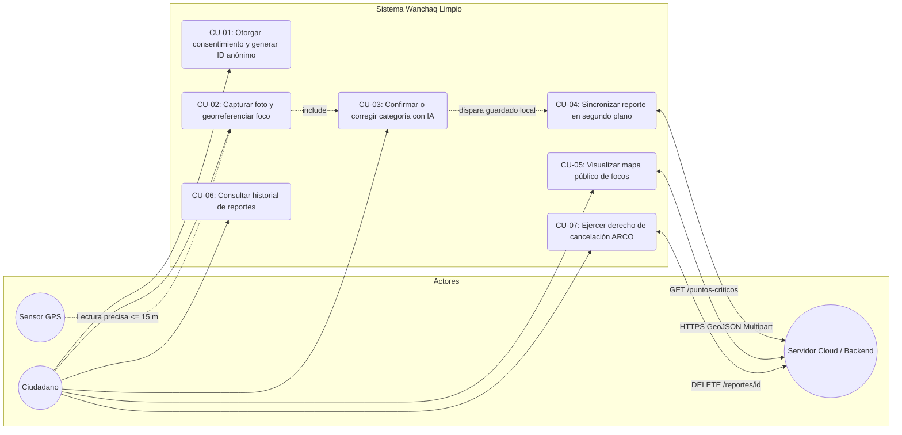
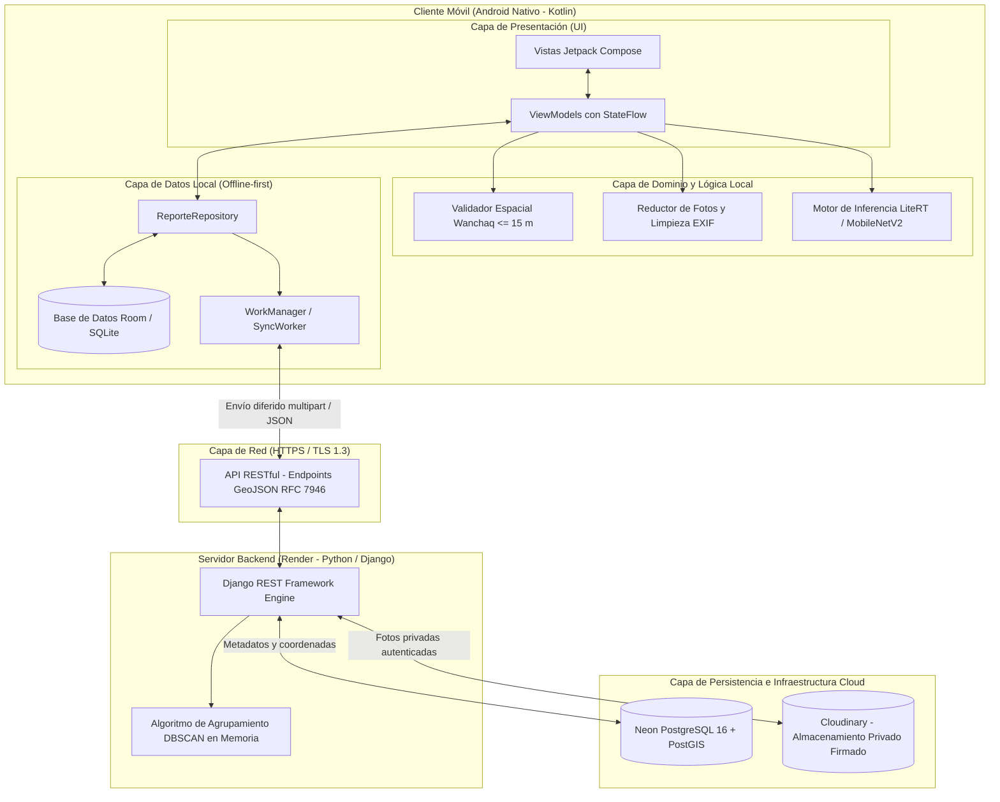
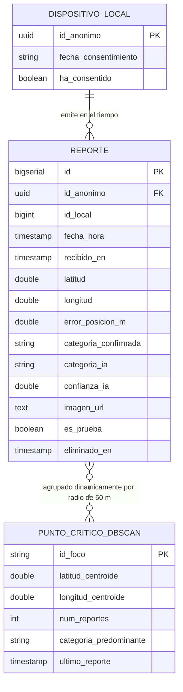

# Subsanación y Actualización — Capítulo IV: Presentación de Resultados y Diseño del Sistema

> **Documento de destino**: `Proyecto de Investigación v5.91 (1) (1).docx`  
> **Sección a sustituir**: Capítulo IV (páginas 55 a 64 del documento Word).  
> **Estado**: Listo para copiar y pegar directamente en el documento de tesis.  
> **Fundamentación técnica**: Código fuente del repositorio, contratos de API en [`docs/diseno.md`](../diseno.md), y Decisiones Arquitectónicas [ADR-0001](../adr/0001-sin-login-id-anonimo.md) al [ADR-0009](../adr/0009-focos-detectados-al-pedir-con-dbscan.md).

---

## RESUMEN DE CAMBIOS EN EL CAPÍTULO IV

| Elemento en v5.91 | Problema en el borrador original | Corrección y Reemplazo Definitivo |
|---|---|---|
| **Tabla 6 (Requisitos Funcionales)** | Exigía registro de usuario con correo/contraseña (`RF-01`) y no contemplaba soporte offline ni inferencia Edge. | Se reformulan los RF: onboarding con consentimiento según Ley N.º 29733 (`RF-01`), precalentamiento GPS $\le 15\text{ m}$ (`RF-02`), offline-first con Room/WorkManager (`RF-03`), inferencia local con MobileNetV2 (`RF-04`), mapa público con Google Maps (`RF-05`) y derecho ARCO de baja remota (`RF-07`). |
| **Tabla 8 e Ilustración 1 (Casos de Uso)** | Contemplaba CU-01 "Registrar Usuario", CU-02 "Iniciar Sesión", CU-10 "Cerrar Sesión" y CU-06 "Categorizar Sucio/Limpio". | Se reemplaza por el catálogo real: CU-01 "Otorgar Consentimiento y Generar ID Anónimo", CU-02 "Capturar y Georreferenciar Foco", CU-03 "Confirmar/Corregir Categoría con IA", CU-04 "Sincronizar Reportes en Segundo Plano", CU-05 "Visualizar Focos en Mapa", CU-06 "Consultar Historial" y CU-07 "Eliminar Reporte Propio". |
| **Ilustración 2 (Arquitectura de Software)** | Mencionaba *Flutter/Dart*, *React.js*, *Node.js/Express* y *AWS S3/Firebase*. | Se sustituye por la arquitectura real: Android Nativo (Kotlin + Jetpack Compose + Room + LiteRT), Backend Python (Django REST Framework en Render), PostgreSQL (Neon) y Cloudinary (fotos privadas firmadas). |
| **Ilustraciones 3, 4 y 5 (Wireframes)** | Mockups conceptuales de iPhone con textos de relleno de generadores (*"Trasha acumumilatior"*, *"Legenda"*). | Se reemplazan por la especificación y diseño de las pantallas reales desarrolladas en Jetpack Compose. |
| **Tablas 9-14 e Ilustración 6 (Base de Datos)** | Incluía la tabla `usuario` con DNI, teléfono y contraseña (violación de minimización de la Ley N.º 29733) y tabla `punto_critico` estática. | Se elimina la tabla `usuario`, se adopta el identificador anónimo `id_anonimo` (UUID) en `Reporte`, y se define la entidad dinámica de focos calculada mediante DBSCAN (`GET /puntos-criticos`). |

---

# TEXTO DEFINITIVO PARA EL CAPÍTULO IV DEL DOCUMENTO WORD

*(A partir de aquí, copiar y reemplazar todo el contenido desde el encabezado del Capítulo IV hasta antes de las Referencias Bibliográficas).*

---

# CAPÍTULO IV: PRESENTACIÓN DE RESULTADOS

## 4.1 Diseño del sistema

El diseño del sistema responde a la necesidad de dotar a los ciudadanos y a la administración municipal de Wanchaq de una plataforma tecnológica eficiente, ética y accesible para el reporte y monitoreo de residuos sólidos en la vía pública. A continuación, se detallan los requisitos del software, las historias de usuario y la especificación formal de los casos de uso.

### 4.1.1 Requisitos del software

#### Requisitos funcionales

La Tabla 6 presenta los requisitos funcionales del sistema, los cuales priorizan la captura rápida sin barreras burocráticas de acceso, el funcionamiento en condiciones de conectividad intermitente (offline-first) y el procesamiento inteligente en el propio dispositivo.

**Tabla 6**  
*Lista de requisitos funcionales del sistema*

| ID | Requisito Funcional | Descripción técnica |
|---|---|---|
| **RF-01** | Consentimiento y generación de identidad anónima | El sistema debe presentar los términos de privacidad y tratamiento de datos antes del primer uso, generando un identificador anónimo pseudoaleatorio (UUID v4) local en el dispositivo tras la aceptación expresa, sin solicitar datos personales (DNI, nombres o correo) en estricto cumplimiento de la Ley N.º 29733. |
| **RF-02** | Captura fotográfica y georreferenciación con precalentamiento | El aplicativo debe permitir la captura de evidencia fotográfica mediante CameraX y registrar simultáneamente las coordenadas satelitales (latitud y longitud), aplicando un precalentamiento del sensor GPS y exigiendo un error de posicionamiento horizontal $\le 15\text{ m}$ restringido al límite administrativo del distrito de Wanchaq. |
| **RF-03** | Persistencia local y sincronización diferida (Offline-first) | El sistema debe almacenar inmediatamente cada reporte válido en una base de datos local SQLite (administrada mediante Room), encolando de manera asíncrona su transmisión al servidor mediante WorkManager cuando se detecte conectividad a Internet validada. |
| **RF-04** | Clasificación automática de residuos con asistencia de IA | El aplicativo debe ejecutar en el dispositivo un modelo de visión artificial ligero (MobileNetV2 en formato TFLite / LiteRT) para sugerir la categoría del residuo (plástico, cartón, vidrio, orgánico), permitiendo al ciudadano confirmar o corregir manualmente la clasificación antes del guardado. |
| **RF-05** | Visualización de focos detectados en mapa público | El sistema debe mostrar un mapa interactivo (Google Maps SDK) encuadrado en el distrito de Wanchaq que renderice los focos de acumulación detectados dinámicamente mediante el algoritmo de agrupamiento DBSCAN, de acceso público sin requerir credenciales. |
| **RF-06** | Seguimiento y trazabilidad de reportes del dispositivo | El aplicativo debe permitir al ciudadano consultar la lista de sus reportes locales («Mis Reportes»), visualizando su estado de entrega (*Pendiente*, *Enviado*, *Rechazado*), cantidad de intentos, fecha y motivo de eventuales fallos de red. |
| **RF-07** | Ejercicio del derecho de supresión (Cancelación ARCO) | El sistema debe permitir al usuario eliminar un reporte propio o la totalidad de sus datos locales, enviando una petición de baja al servidor que remueva la fotografía asociada y registre una lápida lógica (*tombstone* con HTTP 410 Gone) para garantizar la no persistencia de datos revocados. |

*Nota*. Elaboración propia en base a la arquitectura y requerimientos del proyecto.

---

#### Requisitos no funcionales

La Tabla 7 consolida los requisitos no funcionales, estructurados bajo los principios de disponibilidad operativa, seguridad de la información, protección de la privacidad y optimización del consumo de recursos del dispositivo.

**Tabla 7**  
*Lista de requisitos no funcionales del sistema*

| ID | Dimensión | Descripción |
|---|---|---|
| **RNF-01** | Disponibilidad operativa | El aplicativo móvil debe permitir el registro íntegro de reportes aun cuando el dispositivo se encuentre sin conexión a red (modo avión o sin cobertura), garantizando una tasa de sincronización exitosa $\ge 95\%$ una vez restablecida la conexión. |
| **RNF-02** | Privacidad y minimización de datos | El sistema no recolectará datos de filiación personal (DNI, nombres, números telefónicos ni contraseñas) ni almacenará el historial de desplazamiento continuo del usuario. Las fotografías serán privadas, despojadas de metadatos EXIF sensibles antes del envío y reducidas a un tamaño máximo de 1600 px en su lado mayor. |
| **RNF-03** | Seguridad en la transmisión | Toda comunicación entre el cliente móvil y el servidor backend debe realizarse a través del protocolo seguro HTTPS con cifrado TLS 1.3. Las imágenes en la nube se gestionarán con visibilidad autenticada/privada mediante firmas temporales. |
| **RNF-04** | Rendimiento y baja latencia de inferencia | El tiempo de inferencia del clasificador de visión artificial en el dispositivo no debe exceder los 150 milisegundos en procesadores móviles de gama media, evitando bloqueos en el hilo principal de la interfaz de usuario. |
| **RNF-05** | Integridad y filtro de calidad espacial | El sistema debe validar que las coordenadas no sean manipulables manualmente y descartar reportes duplicados emitidos desde el mismo dispositivo a una distancia menor a 20 metros y en un intervalo inferior a 30 minutos. |
| **RNF-06** | Eficiencia en el consumo de datos móviles | El peso de la evidencia fotográfica enviada a la nube no debe superar los 300 KB promedio tras la reducción bilineal y compresión JPEG, minimizando el impacto en los planes de datos de los ciudadanos. |
| **RNF-07** | Tolerancia y resiliencia del backend | El servidor debe responder peticiones de salud en menos de 3 segundos y soportar los reinicios en frío de la infraestructura de hosting en la nube mediante reintentos lineales controlados en el cliente. |

*Nota*. Elaboración propia.

---

### 4.1.2 Historias de usuario

1. **Como ciudadano comprometido**, quiero abrir la aplicación y empezar a reportar inmediatamente tras aceptar el consentimiento informado, sin tener que crear una cuenta con contraseñas o DNI, para que el reporte sea rápido y mi privacidad esté protegida.
2. **Como usuario en la vía pública**, quiero tomar la fotografía de un foco de basura y que el sistema detecte automáticamente mi ubicación precisa con el GPS, para no perder tiempo escribiendo direcciones o calles.
3. **Como ciudadano reportante**, quiero que la aplicación me sugiera automáticamente qué tipo de residuo es (plástico, cartón, etc.) pero me permita corregirlo si la IA se equivoca, para asegurar que la información sea exacta.
4. **Como usuario con datos móviles limitados o en zonas de baja cobertura**, quiero poder guardar mis reportes sin conexión y que el aplicativo los transmita automáticamente cuando vuelva a tener Internet, para que mi información no se pierda.
5. **Como vecino de Wanchaq**, quiero consultar un mapa distrital interactivo con los focos detectados por la comunidad, para conocer las zonas críticas de acumulación de residuos en mi distrito.
6. **Como usuario consciente de mis derechos**, quiero consultar el historial de los reportes enviados desde mi equipo y disponer de un botón para «Borrar todos mis datos» si decido retirar mi participación en el sistema.

---

### 4.1.3 Casos de uso del sistema

La Tabla 8 detalla los casos de uso esenciales del sistema, los cuales reflejan la eliminación del login formal en favor del consentimiento informado y el ciclo completo de captura, asistencia por IA y sincronización resiliente.

**Tabla 8**  
*Casos de uso del sistema*

| ID | Nombre del Caso de Uso | Actor Principal | Descripción |
|---|---|---|---|
| **CU-01** | Otorgar consentimiento y generar identidad anónima | Ciudadano | Presenta los términos del estudio conforme a la Ley N.º 29733. Al presionar «Aceptar y continuar», el sistema genera y almacena un UUID anónimo en `DataStore`, habilitando las funciones del sistema. |
| **CU-02** | Capturar y georreferenciar foco | Ciudadano / Sensor GPS | Activa CameraX para obtener la fotografía del residuo y precalienta el sensor GPS (`LocationServices`). Valida que la precisión sea $\le 15\text{ m}$ y que la posición se ubique dentro de Wanchaq. |
| **CU-03** | Confirmar o corregir categoría de residuo | Ciudadano / Motor de IA | Ejecuta MobileNetV2 sobre la imagen en memoria y presenta la sugerencia en pantalla. El usuario confirma la sugerencia o selecciona manualmente una categoría diferente. |
| **CU-04** | Almacenar y sincronizar reporte (Offline-first) | Sistema (WorkManager) | Persiste el reporte en Room con estado `PENDIENTE`. Al contar con conexión validada, envía la información en formato GeoJSON multipart al servidor, actualizando el estado a `SINCRONIZADO`. |
| **CU-05** | Visualizar mapa público de focos | Ciudadano / Analista | Consulta `GET /puntos-criticos` y dibuja en Google Maps los centroides de acumulación identificados por el algoritmo DBSCAN dentro de los límites de Wanchaq. |
| **CU-06** | Consultar historial de reportes | Ciudadano | Presenta la lista reactiva de reportes asociados al identificador del dispositivo, indicando estado de entrega, hora, intentos y causas de rechazo o demora. |
| **CU-07** | Ejercer derecho de cancelación (Baja remota) | Ciudadano | Permite al usuario borrar un reporte local o todos sus datos. Encola un trabajo en segundo plano que envía un `DELETE` al servidor para remover la foto de Cloudinary y registrar una lápida. |

*Nota*. Elaboración propia.

---

#### Diagrama de casos de uso

La **Ilustración 1** ilustra las interacciones entre los actores (Ciudadano, Sensor GPS y Servidor Backend en la nube) y los casos de uso descritos.

**Ilustración 1**  
*Diagrama de casos de uso del sistema*

---

## 4.2 Arquitectura de la solución planteada

Se implementó una **Arquitectura Cliente-Servidor Desacoplada y Asíncrona**, diseñada bajo el paradigma *Offline-first*. Esta estructura permite desacoplar totalmente la experiencia del usuario en campo respecto a la latencia o disponibilidad de los servicios en la nube.

**Ilustración 2**  
*Arquitectura de la solución planteada*

### 4.2.1 Arquitectura del Cliente (Frontend Android Nativo)
El cliente fue construido en **Kotlin nativo** utilizando **Jetpack Compose** para una interfaz declarativa moderna, estructurado bajo el patrón de arquitectura limpia **MVVM (Model-View-ViewModel)** recomendado por Google:
* **Capa de Presentación**: Comprendida por composables reactivos (`ReporteScreen`, `MapaScreen`, `MisReportesScreen`, `AjustesScreen`) que observan flujos de estado (`StateFlow`) inmutables expuestos por sus respectivos ViewModels, garantizando la recomposición eficiente y libre de fugas de memoria.
* **Capa de Dominio y Negocio Local**:
  * *Validador Geoespacial*: Algoritmo que comprueba que la coordenada obtenida pertenezca al polígono rectangular envolvente del distrito de Wanchaq (latitudes en $[-13.545, -13.515]$ y longitudes en $[-71.990, -71.950]$) y que la precisión declarada por el sensor sea $\le 15\text{ m}$.
  * *Reductor de Fotos*: Módulo que reescala la imagen de la cámara a un tamaño de 1600 px en su dimensión mayor y suprime los metadatos EXIF que contengan coordenadas o marcas de dispositivos.
  * *Clasificador Edge AI*: Ejecuta en un hilo secundario (`Dispatchers.Default`) la inferencia con LiteRT sobre el tensor de entrada $[1, 224, 224, 3]$ preprocesado a partir del bitmap capturado.
* **Capa de Persistencia y Sincronización Local**:
  * *Room Database*: Almacena localmente las entidades `ReporteEntity` garantizando que los datos existan de forma permanente antes de cualquier intento de conexión.
  * *WorkManager*: Planificador del sistema operativo que ejecuta `SyncWorker` y `EliminarReporteWorker` mediante inyección de dependencias (`@HiltWorker`), aplicando políticas de retroceso exponencial (*backoff*) ante indisponibilidad de red.

### 4.2.2 Capa de Comunicación (API RESTful)
La comunicación se fundamenta en un contrato estricto sobre HTTPS utilizando el estándar internacional **GeoJSON (RFC 7946)**:
* `POST /reportes`: Endpoint multiparte que recibe el GeoJSON del reporte (`Feature` con punto `[longitud, latitud]`) y el archivo binario de la imagen. Retorna `201 Created` en el primer envío y `200 OK` si el reporte ya existía (idempotencia garantizada por la clave compuesta `id_anonimo` + `id_local`).
* `GET /puntos-criticos`: Endpoint público que ejecuta en tiempo real el agrupamiento DBSCAN sobre los reportes válidos del distrito y devuelve una `FeatureCollection` con los centroides de los focos de acumulación detectados.
* `DELETE /reportes/{id_anonimo}/{id_local}`: Endpoint de baja que elimina la fotografía en la nube y registra una lápida lógica, retornando `204 No Content` o `410 Gone`.

### 4.2.3 Arquitectura del Backend y Capa de Datos en la Nube
El backend se desplegó en contenedores en la plataforma **Render**, desarrollado en **Python 3.12 con Django REST Framework**:
* **Gestión de Base de Datos**: Conexión cifrada a una instancia de **Neon PostgreSQL 16** con la extensión PostGIS habilitada, optimizada con índices B-Tree sobre las coordenadas y campos de auditoría.
* **Agrupamiento Espacial DBSCAN**: Módulo en memoria (`backend/api/focos.py`) que agrupa reportes utilizando la distancia geodésica de Haversine con un radio de vecindad $\varepsilon = 50\text{ m}$ y $MinSamples = 4$, identificando núcleos compactos de basura y catalogando los reportes aislados como ruido.
* **Almacenamiento Multimedia**: Integración con **Cloudinary** en modo privado autenticado (`type=authenticated`), asegurando que las imágenes nunca sean accesibles por URL pública directa y requieran firmas HMAC con tiempo de expiración.

---

## 4.3 Identificación de interfaces del sistema

El sistema fue diseñado con un enfoque centrado en la usabilidad y la reducción de pasos de interacción, implementando una paleta de colores armónica de tonos verdes y lilas con soporte para pantallas táctiles de diversa escala (teléfonos y tabletas).

### 4.3.1 Pantalla de Onboarding y Consentimiento Informado
Es la primera pantalla visible para el ciudadano. Expone de forma clara la finalidad de la investigación, el carácter voluntario de la participación y el compromiso de no recopilar datos personales identificables conforme a la Ley N.º 29733. El botón «Aceptar y continuar» permanece estrictamente deshabilitado hasta que el usuario marca la casilla de verificación de consentimiento.

### 4.3.2 Pantalla de Captura y Georreferenciación
Constituye el núcleo operativo del cliente móvil. Al abrir la interfaz, el sistema activa la cámara mediante CameraX y precalienta el sensor GPS. Incorpora un indicador visual en tiempo real que informa el estado de la señal: *«Buscando señal satelital…»*, *«GPS listo (±X m)»* cuando la precisión es $\le 15\text{ m}$, o *«Señal débil»* si excede el umbral. Al presionar el botón de disparo, la foto se captura, se reduce en disco y se extrae la mejor lectura satelital sin bloquear la interfaz.

### 4.3.3 Pantalla de Confirmación y Clasificación Inteligente
Presenta al usuario la fotografía capturada junto con la sugerencia automática generada por el modelo de visión artificial (MobileNetV2). Si el modelo supera el umbral de confianza calibrado, la categoría (plástico, cartón, vidrio u orgánico) aparece preseleccionada. El ciudadano tiene la potestad de confirmar la elección o pulsar cualquiera de las otras opciones disponibles (incluyendo *Escombros* o *Mixto*). Al confirmar, el reporte se guarda en la base de datos local y se encola su envío.

### 4.3.4 Pantalla de Mis Reportes (Trazabilidad)
Permite al ciudadano auditar el estado de los reportes generados desde su terminal. Muestra tarjetas organizadas cronológicamente con indicadores de estado: `SINCRONIZADO` (indicando fecha y hora de recepción en el servidor), `PENDIENTE` (indicando cuántos intentos de transmisión se han ejecutado y la causa de la espera, como falta de conexión) o `RECHAZADO`. Cada tarjeta cuenta con opciones para reintentar la transmisión o eliminar el reporte.

### 4.3.5 Pantalla del Visualizador Geoespacial (Mapa Público)
Presenta una vista interactiva de Google Maps acotada geográficamente a Wanchaq. Carga los centroides de acumulación detectados por el algoritmo DBSCAN. Al tocar un marcador, se despliega una tarjeta resumen con la categoría de residuo predominante, la fecha del último reporte que conforma el clúster y la cantidad de reportes ciudadanos que confirmaron dicho foco.

### 4.3.6 Pantalla de Ajustes y Protección de Derechos
Muestra la versión de la aplicación, el correo de contacto institucional para solicitudes de información y expone el **Código Anónimo del Dispositivo**. Desde esta pantalla, el ciudadano puede accionar el botón «Borrar todos mis datos», el cual desencadena la revocación local del consentimiento, el borrado de todas las imágenes locales y la transmisión de órdenes de baja al servidor.

---

## 4.4 Diseño de base de datos

El esquema relacional fue diseñado bajo el principio de minimización de datos. Se prescindió intencionalmente de la tabla tradicional de cuentas de usuario (`usuario`), eliminando la persistencia de contraseñas, correos y números de DNI en los servidores del proyecto.

### 4.4.1 Identificación y descripción de las entidades del sistema

#### Entidad Reporte
Constituye la entidad transaccional central del sistema. Almacena los atributos geoespaciales, temporales y visuales de cada alerta emitida.

**Tabla 9**  
*Estructura de la entidad Reporte*

| Campo | Tipo de dato | Restricción | Descripción |
|---|---|---|---|
| `id` | BIGSERIAL | PK | Identificador autonumérico interno en el servidor. |
| `id_anonimo` | UUID | NOT NULL | Identificador anónimo del dispositivo (v4), generado tras el consentimiento. |
| `id_local` | BIGINT | NOT NULL | Identificador secuencial del reporte en el dispositivo emisor. Clave compuesta con `id_anonimo` (UNIQUE). |
| `fecha_hora` | TIMESTAMP WITH TIME ZONE | NOT NULL | Marca temporal precisa de la captura en el teléfono (UTC). |
| `recibido_en` | TIMESTAMP WITH TIME ZONE | NOT NULL | Marca temporal de recepción y aceptación en el servidor backend. |
| `latitud` | DOUBLE PRECISION | NOT NULL | Coordenada latitudinal en el elipsoide WGS84 (EPSG:4326). |
| `longitud` | DOUBLE PRECISION | NOT NULL | Coordenada longitudinal en el elipsoide WGS84 (EPSG:4326). |
| `error_posicion_m` | DOUBLE PRECISION | NULL | Radio de precisión horizontal declarado por el sensor GPS al momento de la captura (en metros). |
| `categoria_confirmada` | VARCHAR(20) | NOT NULL | Categoría validada por el ciudadano (`PLASTICO`, `CARTON`, `VIDRIO`, `ORGANICO`, `ESCOMBROS`, `MIXTO`). |
| `categoria_ia` | VARCHAR(20) | NULL | Categoría inferida originalmente por el modelo MobileNetV2. |
| `confianza_ia` | DOUBLE PRECISION | NULL | Probabilidad matemática (0.00 a 1.00) asignada por la red neuronal. |
| `imagen_url` | TEXT | NOT NULL | Identificador y URL segura del recurso fotográfico en Cloudinary. |
| `es_prueba` | BOOLEAN | DEFAULT FALSE | Bandera que segrega registros de calibración/pruebas de los datos válidos del estudio. |
| `eliminado_en` | TIMESTAMP WITH TIME ZONE | NULL | Marca temporal de baja (lápida lógica) para el cumplimiento de derechos ARCO. |

*Nota*. Estructura del modelo `Reporte` implementado en `backend/api/models.py`.

---

#### Entidad Punto_Critico (Agrupación DBSCAN)
Los puntos críticos no se almacenan como tablas estáticas susceptibles a desactualización, sino que se computan de forma dinámica en memoria mediante el algoritmo DBSCAN cada vez que se requiere la visualización del mapa.

**Tabla 10**  
*Atributos de la estructura computada de Punto Crítico*

| Atributo | Tipo de dato | Descripción |
|---|---|---|
| `id_foco` | VARCHAR(64) | Identificador unívoco y determinístico derivado de las coordenadas del clúster. |
| `latitud_centroide` | DOUBLE PRECISION | Latitud media de los reportes que conforman el núcleo de acumulación. |
| `longitud_centroide` | DOUBLE PRECISION | Longitud media de los reportes que conforman el núcleo de acumulación. |
| `num_reportes` | INTEGER | Cantidad de reportes individuales confirmados que integran la agrupación ($n \ge 4$). |
| `categoria_predominante`| VARCHAR(20) | Tipo de residuo que presenta mayor frecuencia relativa dentro del foco. |
| `ultimo_reporte` | TIMESTAMP WITH TIME ZONE | Fecha y hora del reporte más reciente incorporado a la agrupación. |

*Nota*. Generado por el módulo analítico `backend/api/focos.py`.

---

### 4.4.2 Diagrama Entidad-Relación

La **Ilustración 6** describe la estructura relacional y lógica de los datos administrados por el sistema, destacando la independencia respecto a cuentas personales y la vinculación asíncrona entre reportes individuales y focos detectados.

**Ilustración 6**  
*Diagrama Entidad-Relación del sistema*
