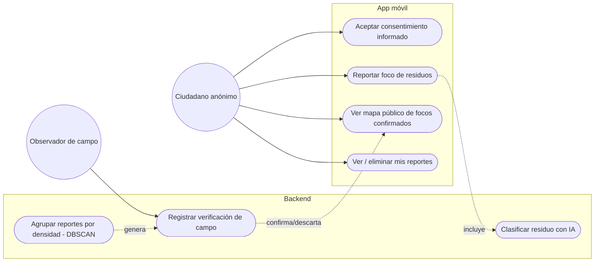
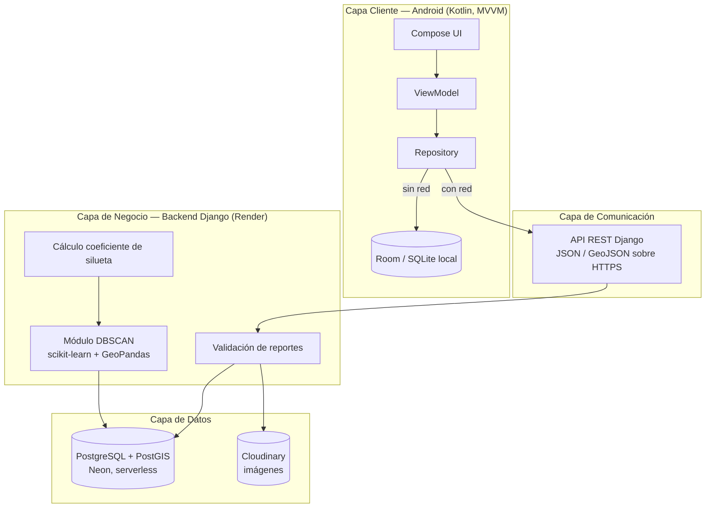
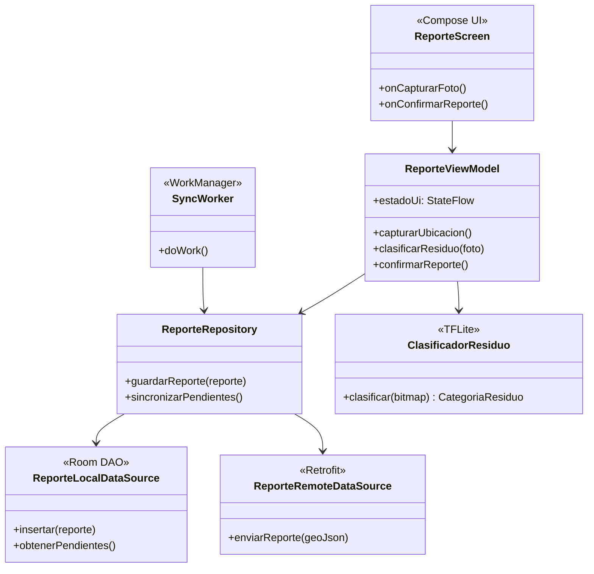
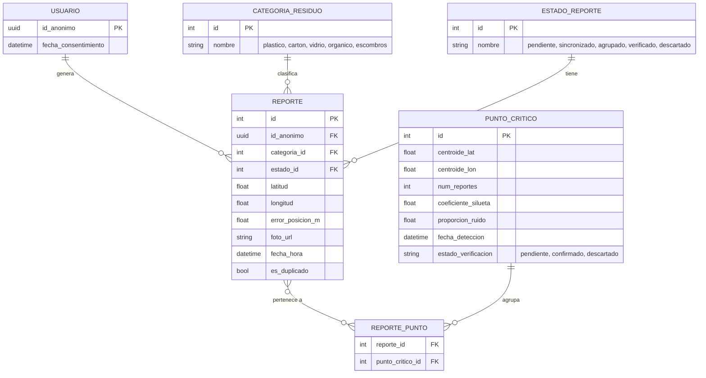
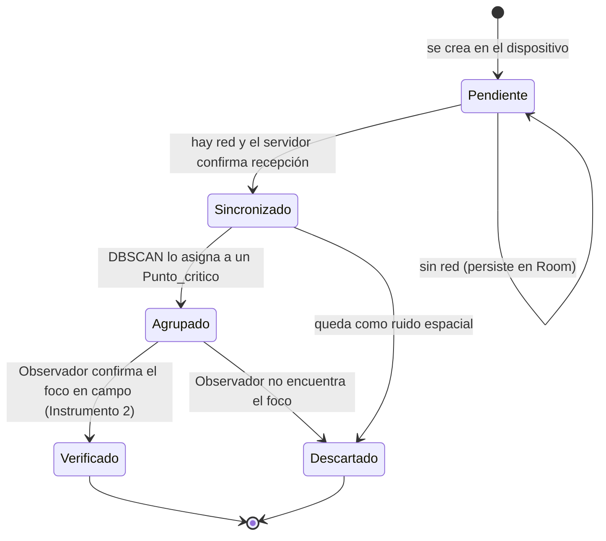
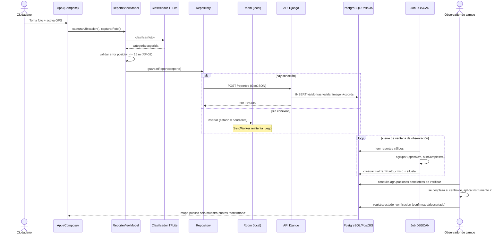

# Diseño del Sistema — Wanchaq Limpio

> Este documento traduce los Capítulos I, II y III del Proyecto de Investigación v5.91 en un diseño de software concreto. Es un documento vivo: se ajusta a medida que avanza el desarrollo. Ver [`progreso.md`](./progreso.md) para el registro de sesiones.

## 0. Criterio de elaboración de este diseño

El documento de investigación tiene un apartado de diseño (Capítulo IV) que **no se sigue al 100%**, porque contradice compromisos ya asumidos en los Capítulos I–III. Este diseño prioriza esos tres capítulos como fuente de verdad — el problema, los objetivos, las variables y dimensiones (Anexo 2), la metodología y, sobre todo, la ética de la investigación — y solo conserva del Capítulo IV lo que es consistente con ellos.

> La tabla de abajo resume las 5 contradicciones principales. El listado completo y detallado (8 correcciones, incluyendo hallazgos del contenido real de las Tablas 6-13 del documento, como campos faltantes en el modelo de datos o una contraseña almacenada en texto plano) vive en [`correcciones-documento.md`](./correcciones-documento.md) — esa es la fuente de verdad actualizada; esta tabla es solo un resumen de las de mayor impacto de diseño.

### Contradicciones detectadas entre el Capítulo IV y los Capítulos I–III

| # | Lo que dice el Cap. IV | Lo que exigen los Cap. I–III | Resolución adoptada |
|---|---|---|---|
| 1 | Pantalla de inicio pide **nombre completo, correo electrónico y contraseña** (3.6 pantallas) | Ética (3.4, Ley N.º 29733): "no solicita nombre real, documento de identidad ni número telefónico"; cada usuario recibe **un identificador anónimo generado en el dispositivo** | Sin login. Se genera un UUID anónimo local al aceptar el consentimiento informado (Anexo 9). No hay pantalla de credenciales. |
| 2 | Entidad `Usuario` "almacena los datos de las cuentas de todos los ciudadanos que se registran" | Minimización de datos: solo coordenadas, fecha/hora, foto y código anónimo | `Usuario` se redefine como un registro mínimo: `id_anonimo`, fecha de aceptación del consentimiento — sin credenciales ni PII |
| 3 | Historia de usuario: "Como ciudadano, quiero cerrar mi sesión, para que nadie más use mi cuenta" | No existe concepto de cuenta ni sesión autenticada en el modelo ético descrito | Se reemplaza por "eliminar mis reportes / revocar mis datos", que sí está previsto en Ética (3.4, "Derechos del titular") |
| 4 | Historia de usuario: "Como administrador, quiero visualizar todos los puntos en un mapa base" | 3.2 "Sobre las entidades gestoras": *"la visibilidad pública, no la administración interna, es el principal propósito de los datos"*; la municipalidad es **destinataria**, no usuaria del sistema | El mapa es una vista pública de solo lectura sobre **puntos críticos confirmados** (agrupaciones verificadas), no un panel administrativo con rol privilegiado |
| 5 | Pantalla de reporte no distingue entre reporte crudo y foco confirmado | Marco conceptual (Cap. II): un "foco" solo existe tras el agrupamiento DBSCAN + verificación en campo (Instrumento 2) | El mapa público muestra `Punto_critico` (agregado y verificado), nunca `Reporte` individual crudo — coherente además con el criterio de anonimato y con la advertencia de Goodchild sobre calidad heterogénea del dato voluntario |

Todo lo demás del Cap. IV que **sí** es consistente (arquitectura cliente-servidor, capa REST, PostgreSQL con PostGIS, patrón offline-first, entidades `Categoria_residuo`, `Estado_reporte`, `Reporte`, `Punto_critico`, `Reporte_punto`) se mantiene y se detalla a continuación.

---

## 1. Trazabilidad: de variables/dimensiones (Anexo 2) a requisitos funcionales

| Variable | Dimensión | Requisito funcional derivado | Responsable |
|---|---|---|---|
| V1. Sistema móvil | Completitud del diseño | *(criterio de verificación documental, no es un RF de software — se satisface con este documento y sus artefactos)* | — |
| V1 | Conformidad funcional | *(criterio de verificación: contraste Product Backlog vs. Sprint entregado)* | Gestión de proyecto |
| V1 | Usabilidad percibida | **RF-01** Registrar un foco en el menor número de pasos posible (captura de foto + GPS automático + confirmación) | Cliente Android |
| V1 | Precisión geoespacial | **RF-02** Descartar en el dispositivo, antes de guardar, todo reporte con error de posicionamiento > 15 m **o cuya coordenada caiga fuera del límite administrativo del distrito de Wanchaq** (no de la provincia de Cusco — ver `correcciones-documento.md`, CORR-007) | Cliente Android |
| V1 | Disponibilidad operativa | **RF-03** Almacenar el reporte localmente si no hay red y sincronizarlo cuando se restablezca | Cliente Android |
| V1 | Exactitud de clasificación automática | **RF-04** Clasificar la fotografía en una de las 5 categorías de residuo usando el modelo on-device, con opción de corrección manual | Cliente Android |
| V2. Monitoreo de focos | Identificación de focos | **RF-05** Agrupar los reportes válidos por densidad espacial (DBSCAN) | Backend |
| V2 | Calidad del agrupamiento | **RF-06** Calcular el coeficiente de silueta y la proporción de ruido espacial por corrida de agrupamiento | Backend |
| V2 | Caracterización del foco | **RF-07** Registrar, para cada agrupación confirmada en campo, tipo de residuo predominante, volumen y tipo de entorno urbano (Instrumento 2) | Herramienta de campo / backend |
| V2 | Evidencia documental | **RF-08** Exigir al menos una fotografía válida (sin rostros ni placas reconocibles) por reporte | Cliente Android |
| V2 | Calidad del registro | **RF-09** Marcar como completo un reporte solo si tiene coordenadas, fecha/hora y categoría | Cliente Android + backend |

## 2. Requisitos no funcionales (RNF)

| ID | Requisito | Origen |
|---|---|---|
| RNF-01 | La app debe operar sin conexión y no perder reportes generados offline | 3.6.3 Offline-first / Delimitación: Conectividad |
| RNF-02 | `minSdk` = 26 (Android 8.0) | Materiales, Anexo de recursos de software |
| RNF-03 | Ninguna fotografía enviada puede contener rostros o placas identificables | Ley N.º 29733 / Ética |
| RNF-04 | No se solicita ni almacena nombre real, DNI ni teléfono en ningún flujo | Ética, minimización de datos |
| RNF-05 | El usuario puede eliminar sus propios reportes desde la app en cualquier momento | Ética, derechos del titular |
| RNF-06 | El intercambio cliente-servidor usa GeoJSON (RFC 7946) | 3.6.4 Procesos de implementación |
| RNF-07 | Duplicados del mismo dispositivo en <30 min y <20 m se descartan antes de análisis | Criterios de exclusión, 3.2 |

---

## 3. Actores y casos de uso

Actores reales según Cap. I–III (no "administrador" ni "usuario con cuenta"):

- **Ciudadano (anónimo)**: reporta focos; es el "sensor humano" de la ciencia ciudadana (Goodchild).
- **Sistema de clasificación (IA on-device)**: actor de soporte, sugiere categoría de residuo.
- **Sistema de agrupamiento (DBSCAN, backend)**: actor de soporte, agrupa reportes en focos.
- **Observador de campo**: rol metodológico real (Fase 2, Instrumento 2), aplica la Ficha de Observación de Campo sobre cada agrupación.
- **Municipalidad de Wanchaq**: destinataria pasiva de la información pública; no inicia casos de uso dentro de la app.

---

## 4. Arquitectura general del sistema (capas)

---

### 4.1 Despliegue e infraestructura

| Componente | Servicio | Nota |
|---|---|---|
| API Django | Render (plan Free) | Web service sin costo. Se "duerme" tras ~15 min de inactividad (cold start de decenas de segundos). |
| Base de datos | Neon (PostgreSQL + PostGIS, serverless) | Soporta la extensión PostGIS. Autosuspend propio, pero el resume es del orden de milisegundos/segundos, mucho más rápido que el cold start de Render. |
| Almacenamiento de imágenes | Cloudinary (plan Free) | CDN + transformaciones de imagen; no tiene problema de cold start al no ser un servidor de aplicación. |

**Riesgo metodológico a documentar**: el cold start de Render (plan Free) puede hacer que una sincronización falle o tarde justo en el momento en que se mide el indicador *"Reportes guardados y sincronizados según condición de red, ≥ 95% en cada condición"* (Anexo 2) — no porque el diseño offline-first de la app falle, sino porque la infraestructura gratuita estaba dormida. Para no contaminar esa métrica con un artefacto de hosting:

- Se configura un **pinger externo gratuito** (p. ej. cron-job.org) que llama a un endpoint `/health` del backend cada 10 minutos durante toda la ventana de observación (Fase 1, 8 semanas), manteniendo el servicio activo sin costo.
- Esta decisión se documenta explícitamente en la metodología (limitaciones) para que, si igualmente ocurre algún cold start, quede claro que es un artefacto de infraestructura y no del sistema evaluado.
- Alternativa sin workaround si el pinger no resulta suficientemente confiable: subir el plan de Render a Starter (~US$7/mes) solo durante esas 8 semanas.

### 4.2 Contrato de la API REST (cliente ↔ backend)

Definido por el cliente (Módulos 4 y 6) antes de que exista el backend, para que este se construya contra un contrato explícito. Las pruebas del cliente lo simulan con `MockWebServer3`.

| Operación | Petición | Respuestas esperadas | Garantías que debe dar el backend |
|---|---|---|---|
| Subir un reporte | `POST /reportes` · `multipart/form-data`: parte `foto` (JPEG) + parte `geojson` (Feature RFC 7946, ver abajo) | `2xx` = recibido | **Idempotente por `(idAnonimo, idLocal)`**: un reenvío del mismo reporte no crea un duplicado (el cliente reintenta si la respuesta se pierde) |
| Dar de baja un reporte | `DELETE /reportes/{idAnonimo}/{idLocal}` | `204` = borrado · `404` = no existía | **Idempotente**. El cliente trata `2xx` y `404` como éxito. **Debe registrar una lápida** de `(idAnonimo, idLocal)` para rechazar (`410 Gone`) un `POST` tardío posterior: cierra las carreras "respuesta perdida" y "subida en vuelo mientras el usuario borra" |

**Payload `geojson`**: `Feature` con `geometry.Point` en orden `[longitud, latitud]` y `properties = { idAnonimo, idLocal, categoria, fechaHoraEpochMillis }`. `idLocal` es el id del reporte en la base local del dispositivo; junto con `idAnonimo` es la clave natural del reporte en el servidor.

**Seguridad (limitación asumida, ADR-0002)**: al no haber login, `(idAnonimo, idLocal)` funciona como credencial de capacidad para la baja. Es aceptable porque `idAnonimo` es un UUID aleatorio que no se expone públicamente (el mapa público solo muestra `Punto_critico`), pero el backend **no debe** devolverlo en ninguna respuesta pública ni registrarlo en logs de acceso abiertos.

**Política pendiente**: qué ocurre con un `Punto_critico` cuando se da de baja un reporte que lo integraba (recalcular la agrupación, marcarlo, o congelar tras la ventana de observación). A definir con el asesor; ver ADR-0002.

## 5. Arquitectura interna del cliente Android (MVVM + Repository, offline-first)

**Responsabilidades clave**

- `ReporteViewModel`: coordina captura de GPS (filtra > 15 m localmente, RF-02) y foto, invoca al clasificador on-device (RF-04).
- `ReporteRepository`: única fuente de verdad. Si hay red, envía por Retrofit; si no, persiste en Room y deja el reporte en estado `pendiente`.
- `SyncWorker` (WorkManager): reintenta el envío de reportes `pendiente` cuando la conectividad se restablece (RNF-01, RF-03).
- `ClasificadorResiduo`: envuelve el intérprete de TensorFlow Lite (modelo MobileNetV2 reentrenado, ver `progreso.md`). Solo **sugiere**: el usuario siempre puede corregir (RF-04). Si la confianza queda bajo el umbral del modelo, propone `MIXTO`. No puede sugerir `ESCOMBROS` (ver el contrato abajo).

**Contrato del modelo de IA (Colab ↔ app)** — el modelo se entrena fuera de la app ([`ml/`](../ml/README.md)) y se comunica con ella solo por tres archivos en `app/src/main/assets/`. Cualquier cambio en un lado exige cambiarlo en el otro; el orden de las clases se comprueba automáticamente contra el enum `CategoriaResiduo` (ver `pruebas.md`).

| Aspecto | Valor |
|---|---|
| Entrada | `float32 [1, 224, 224, 3]`, RGB, píxeles 0–255 **sin normalizar** (la normalización va dentro del modelo, para no duplicar el preprocesado en Kotlin) |
| Salida | `float32 [1, 4]`, softmax, en el orden de `labels.txt`: `plastico, carton, vidrio, organico` |
| Categorías **manuales** | `ESCOMBROS` y `MIXTO` **no** son clases del modelo (`metadata.json → categorias_manuales`); el ciudadano las elige a mano. `MIXTO` es además el "no sé" que la app propone cuando la confianza máxima < `umbral_confianza_sugerido`. `ESCOMBROS` salió del modelo el 2026-09-18 (sin dataset público y se confunde con muros y veredas) pero sigue siendo una categoría de la investigación ("Desmonte y escombros" en la ficha de campo) |
| Archivos | `clasificador_residuos.tflite` (float16), `labels.txt`, `metadata.json` (umbral, `sha256`, fuentes y conteo del dataset) |
| Privacidad | La clasificación ocurre **en el teléfono**: la foto no viaja a ningún servidor para clasificarse (ADR-0001) |

---

## 6. Modelo de datos (diagrama entidad-relación corregido)

Ajustes respecto al Cap. IV: `Usuario` pierde credenciales y pasa a ser un identificador anónimo; se agrega el campo de precisión (`error_posicion_m`) exigido por el criterio de inclusión de 15 m; `Punto_critico` incorpora los campos de calidad de agrupamiento (silueta, ruido) que exige la dimensión "calidad del agrupamiento".

> Nota: `id_anonimo` se genera localmente en el dispositivo (UUID v4) al aceptar el consentimiento informado (Anexo 9) y no se vincula a ningún dato personal. Su único propósito técnico es permitir el filtro de duplicados (RNF-07: mismo dispositivo, <30 min, <20 m) y el borrado de "mis reportes" (RNF-05).

---

## 7. Ciclo de vida de un `Reporte` (diagrama de estados)

---

## 8. Flujo de datos extremo a extremo (secuencia)

---

## 9. Pantallas (wireframes textuales corregidos)

| Pantalla | Contenido | Cambia respecto al Cap. IV porque... |
|---|---|---|
| **Onboarding + Consentimiento** | Texto del Anexo 9, checkbox de aceptación, genera `id_anonimo` local | Reemplaza a la pantalla de login (sin correo/contraseña) |
| **Mapa** | Solo lectura. Muestra `Punto_critico` con `estado_verificacion = confirmado`. Sin edición | Ya no muestra reportes crudos individuales; evita exponer datos no verificados |
| **Reportar foco** | Cámara (RF-08), GPS automático con validación de precisión (RF-02), categoría sugerida por IA editable (RF-04), botón confirmar/reintentar | Se mantiene del Cap. IV, es consistente con Cap. I–III |
| **Mis reportes** | Lista de reportes hechos desde este dispositivo (por `id_anonimo`), con opción de eliminar | Reemplaza el concepto de "perfil de cuenta"; implementa RNF-05 |
| **Ajustes** *(implementado en el Módulo 7)* | Propósito de la app y versión; código anónimo del dispositivo (seleccionable, para citarlo al pedir acceso/rectificación/cancelación por correo); correo de contacto público con botón para escribir; **"Borrar todos mis datos"** (elimina reportes y fotos, solicita su baja en el backend y revoca el consentimiento; con confirmación explícita) | Se mantiene del Cap. IV sin el ítem "cerrar sesión" (ADR-0001) y **sin el "cambio de idioma"**, diferido por decisión del usuario (CORR-009). "Revocar consentimiento" y "borrar datos" se fusionan en una sola acción porque una sin la otra dejaría datos huérfanos (ADR-0002) |

---

## 10. Metodologías y notación empleadas

- **Arquitectura en capas** (cliente / comunicación / negocio / datos), tal como exige el Cap. IV del documento y se mantiene aquí.
- **MVVM + patrón Repository** (arquitectura recomendada por Google para Android) para separar UI, estado y origen de datos, habilitando el enfoque *offline-first* exigido por la Delimitación (Conectividad) del Cap. I.
- **Diagramas UML adaptados** (casos de uso, clases, estados, secuencia) en notación Mermaid, embebidos en Markdown para que vivan junto al código y se revisen en cada PR.
- **Diagrama entidad-relación** en notación Mermaid `erDiagram`, derivado de las entidades del Cap. IV pero corregido según el punto 0.
- **Matriz de trazabilidad** (variable → dimensión → requisito funcional) como técnica de ingeniería de requisitos, para poder demostrar en la tesis que cada indicador de la matriz de operacionalización (Anexo 2) tiene un artefacto de software que lo satisface.

---

## 11. Próximos pasos

1. Validar este diseño corregido con el asesor de tesis — se aparta del Capítulo IV entregado y esa desviación debe quedar sustentada también en el documento académico, no solo aquí.
2. Definir `applicationId` final y homologar `targetSdk` (ver `progreso.md`, pendientes).
3. Crear la estructura de paquetes Android reflejando este diseño (`data/local`, `data/remote`, `data/repository`, `ui/reporte`, `ui/mapa`, `ui/misreportes`, `ml/clasificador`).
4. Implementar el modelo Room a partir del ER de la sección 6.
5. Implementar la pantalla de Reporte (offline-first) como primer incremento vertical, por ser el flujo crítico de todo el sistema.
