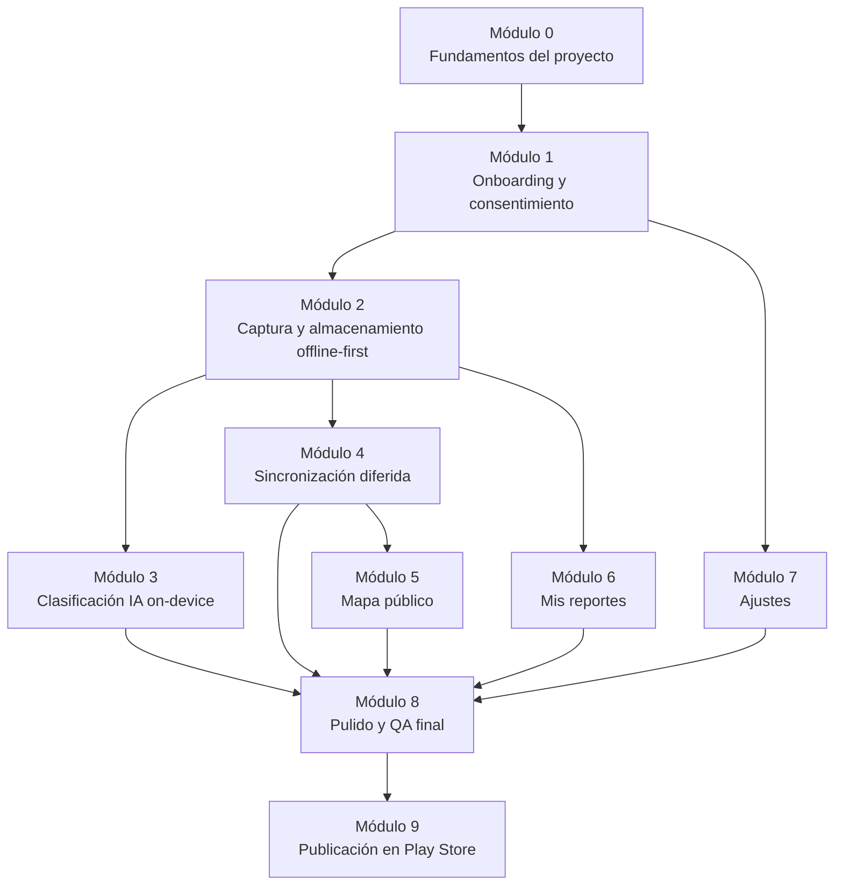

# Plan de Desarrollo — Wanchaq Limpio

> Hoja de ruta del cliente Android, dividida en módulos incrementales. Cada módulo es una porción vertical (UI + lógica + datos) que deja la app en un estado funcional y probado. Se apoya en [`diseno.md`](./diseno.md) (arquitectura y requisitos) y se registra en [`progreso.md`](./progreso.md) (avance real).

## 0. Cómo usar este plan

- Los módulos están numerados en el **orden recomendado de construcción** (cada uno depende de que el anterior esté terminado, salvo que se indique lo contrario).
- Cada módulo trae: objetivo, requisitos que satisface (RF/RNF de `diseno.md`), entregables, dependencias, pruebas mínimas y **Definition of Done**.
- Al cerrar un módulo: marcar su checklist aquí, añadir una entrada en `progreso.md`, y si algo del diseño cambió durante la construcción, reflejarlo en `diseno.md`.
- Este documento no fija fechas ni duraciones — el ritmo depende de las sesiones de trabajo, no de un cronograma fijo.

---

## 1. Principios y buenas prácticas

### 1.1 Código

- **Convención de Kotlin oficial** ([kotlinlang.org/docs/coding-conventions](https://kotlinlang.org/docs/coding-conventions.html)): `PascalCase` para clases/interfaces, `camelCase` para funciones/variables, `UPPER_SNAKE_CASE` para constantes.
- **Inmutabilidad por defecto**: `val` antes que `var`; `data class` para modelos; listas expuestas como `List`, nunca `MutableList`, fuera de la capa que las construye.
- **Estado de UI explícito**: cada pantalla expone un único `StateFlow<UiState>` (sealed class: `Loading`, `Success`, `Error`) desde su ViewModel — nunca variables sueltas de estado en la UI.
- **Corrutinas y `Flow`** para todo trabajo asíncrono (red, base de datos, sensores); nada de callbacks anidados.
- **Inyección de dependencias con Hilt**: ninguna clase instancia manualmente su `Repository`, DAO o servicio Retrofit; todo se provee vía módulos Hilt. Evita el acoplamiento y facilita las pruebas con dobles de prueba.
- **Manejo de errores explícito**: las funciones de `Repository` devuelven un `Result<T>` (o sealed class `Outcome`) en vez de lanzar excepciones no controladas hacia el ViewModel.
- **Una responsabilidad por clase**: si un ViewModel empieza a coordinar más de una pantalla o un Repository empieza a hablar con más de una fuente de datos sin mediar un mapper, se divide.
- **Análisis estático**: `ktlint` (formato) + `detekt` (reglas de complejidad/estilo) corriendo en cada build local, ver Módulo 0.

### 1.2 Estructura de proyecto

- **Organización híbrida**: capas técnicas de alto nivel (`core`, `data`, `domain`, `ml`, `ui`) y, dentro de `ui`, un paquete por feature (`onboarding`, `reporte`, `mapa`, `misreportes`, `ajustes`). Evita tanto el "todo en un paquete" como el "un paquete por cada clase individual".
- **`domain` sin dependencias de Android**: los modelos de dominio (`Reporte`, `PuntoCritico`, `CategoriaResiduo`) son Kotlin puro, sin anotaciones de Room ni Retrofit, para poder testear reglas de negocio sin el framework de Android.
- **Un archivo, una clase pública** (salvo `sealed class` con sus subtipos, o extensiones muy pequeñas y relacionadas).
- Ver el árbol completo en la sección 2.

### 1.3 Control de versiones

- Inicializar git en `wanchac_app` (**pendiente**, ver Módulo 0) antes de escribir código de negocio — sin esto no hay forma segura de revertir un experimento fallido.
- Ramas: `main` siempre compilable; trabajo en `feature/<modulo>-<detalle>` (ej. `feature/02-captura-reporte`).
- Commits en [Conventional Commits](https://www.conventionalcommits.org/): `feat:`, `fix:`, `docs:`, `refactor:`, `test:` — facilita generar un changelog más adelante y entender el historial en la sustentación.
- No commitear `local.properties`, `*.tflite` de más de unos MB sin Git LFS, ni claves de API — ya cubierto por el `.gitignore` generado por Android Studio, pero revisarlo antes del primer commit.

### 1.4 Documentación

- **KDoc** en toda clase/función pública que no sea autoevidente por su nombre (mismo criterio que en código: si el nombre ya lo dice, no se documenta).
- **ADR (Architecture Decision Record)** para cada decisión que se aparte del documento de investigación o que sea difícil de revertir — ejemplo ya creado: [`adr/0001-sin-login-id-anonimo.md`](./adr/0001-sin-login-id-anonimo.md). Nuevas decisiones de ese tipo van en `docs/adr/000X-titulo.md`.
- `progreso.md` se actualiza **al cierre de cada sesión**, no al final del proyecto — es un registro, no un resumen retrospectivo.
- `diseno.md` se actualiza si la implementación obliga a cambiar algo del diseño (ej. un campo nuevo en una entidad) — el diagrama y el código nunca deben divergir en silencio.

### 1.5 Pruebas

El proyecto ya trae escafoldado por el wizard: JUnit4, AndroidX Test (`androidx.test.ext:junit`), Espresso, Compose UI Testing. Se suman:

| Tipo de prueba | Herramienta | Cuándo es obligatoria |
|---|---|---|
| Unitaria (ViewModel, Repository, mappers) | JUnit4 + [MockK](https://mockk.io/) + `kotlinx-coroutines-test` | Todo módulo que toque lógica de negocio (2 a 8) |
| Flujos reactivos (`StateFlow`/`Flow`) | [Turbine](https://github.com/cashapp/turbine) | Módulos 1, 2, 4 |
| Base de datos local | Room in-memory + AndroidX Test | Módulo 2 |
| UI (Compose) | Compose Testing (`ui-test-junit4`, ya incluido) | Flujo crítico de cada pantalla (feliz + error) |
| Modelo de IA | Test unitario con set fijo de imágenes de referencia | Módulo 3 |

**Definition of Done de pruebas**: no se marca un módulo como cerrado sin al menos una prueba unitaria del `Repository`/`ViewModel` involucrado y una prueba de UI del flujo principal.

**Documentación de pruebas**: cada caso de prueba escrito se registra en [`pruebas.md`](./pruebas.md) (qué verifica, requisito/dimensión relacionada) — no en `progreso.md`, que solo referencia ese archivo. `pruebas.md` también acumula notas técnicas de testing (configuración necesaria, bugs de entorno ya diagnosticados) para no repetir el mismo diagnóstico dos veces.

---

## 2. Estructura de carpetas propuesta

```
app/src/main/java/<paquete-base>/
├── WanchaqLimpioApp.kt              # Application class, @HiltAndroidApp
├── core/
│   ├── di/                          # Módulos Hilt (Network, Database, Location)
│   ├── network/                     # Retrofit/OkHttp, interceptores, (de)serializador GeoJSON
│   ├── location/                    # Wrapper FusedLocationProvider + filtro de precisión (RF-02)
│   ├── sync/                        # SyncWorker (WorkManager)
│   └── util/                        # Result/Outcome, extensiones, Constants
├── data/
│   ├── local/
│   │   ├── db/                      # RoomDatabase, DAOs
│   │   └── entity/                  # @Entity (Room) — reflejan diseno.md §6
│   ├── remote/
│   │   ├── api/                     # Interfaces Retrofit (ReportesApi, PuntosCriticosApi)
│   │   └── dto/                     # DTOs GeoJSON (RFC 7946)
│   ├── mapper/                      # Entity <-> DTO <-> Modelo de dominio
│   └── repository/                  # Implementaciones de domain/repository
├── domain/
│   ├── model/                       # Reporte, PuntoCritico, CategoriaResiduo, EstadoReporte (Kotlin puro)
│   └── repository/                  # Interfaces (ReporteRepository, PuntoCriticoRepository)
├── ml/
│   └── clasificador/                # ClasificadorResiduo (wrapper TFLite), modelo en assets/
└── ui/
    ├── theme/                       # Ya generado por el wizard
    ├── onboarding/                  # Consentimiento + generación id_anonimo (Módulo 1)
    ├── reporte/                     # Reportar foco (Módulo 2 y 3)
    ├── mapa/                        # Mapa público de puntos críticos (Módulo 5)
    ├── misreportes/                 # Mis reportes (Módulo 6)
    └── ajustes/                     # Acerca de / revocar consentimiento (Módulo 7)
```

> `<paquete-base>` = `com.wanchaqlimpio.app` (definitivo, ver `progreso.md`, Sesión 8).

---

## 3. Módulos de desarrollo



### Módulo 0 — Fundamentos del proyecto

- **Objetivo**: dejar el esqueleto técnico listo para construir features sin retrabajo posterior.
- **Entregables**:
  - `git init` + primer commit + `.gitignore` verificado
  - ~~Definición final de `applicationId`~~ → hecho, `com.wanchaqlimpio.app` (ver `progreso.md`, Sesión 8). Falta homologar `targetSdk`
  - Hilt configurado (`@HiltAndroidApp`, módulo base)
  - Retrofit + OkHttp configurados apuntando a un backend mock o `BASE_URL` de desarrollo
  - Room configurado con una entidad de prueba (se reemplaza en Módulo 2)
  - `ktlint` + `detekt` corriendo (`./gradlew ktlintCheck detekt`)
  - Estructura de paquetes de la sección 2 creada (vacía, con `.gitkeep` o clases placeholder)
- **Depende de**: nada (es el punto de partida)
- **Definition of Done**: `./gradlew build` pasa en verde, estructura de paquetes existe, git inicializado.

### Módulo 1 — Onboarding y consentimiento

- **Objetivo**: pantalla obligatoria de consentimiento informado (Anexo 9) que genera el identificador anónimo del dispositivo.
- **Requisitos que satisface**: RNF-04, RNF-05 (base), ADR-0001.
- **Entregables**:
  - Pantalla Compose con el texto del Anexo 9 y checkbox de aceptación
  - Generación de `id_anonimo` (UUID v4) persistido en DataStore (no en Room, para que sobreviva reinstalaciones solo si se decide así — a definir)
  - Bloqueo de navegación a "Reportar" hasta aceptar
- **Depende de**: Módulo 0
- **Pruebas**: unit test de generación/persistencia del UUID; UI test del flujo de aceptación/rechazo.

### Módulo 2 — Captura y almacenamiento offline-first

- **Objetivo**: el flujo crítico del sistema — reportar un foco funciona con o sin conexión.
- **Requisitos que satisface**: RF-02, RF-03, RF-08, RF-09, RNF-01, RNF-07.
- **Entregables**:
  - Entidades Room (`Reporte`, `CategoriaResiduo`, `EstadoReporte`) según `diseno.md` §6
  - Integración CameraX (captura de foto)
  - Integración FusedLocationProvider + filtro de precisión ≤ 15 m **y validación de límite distrital de Wanchaq** (descarta antes de guardar; ver `correcciones-documento.md`, CORR-007)
  - Lógica de duplicados (mismo `id_anonimo`, < 30 min, < 20 m) antes de persistir
  - `ReporteRepository` con lógica offline-first (guarda local si no hay red)
- **Depende de**: Módulo 1 (necesita `id_anonimo`)
- **Pruebas**: Room in-memory (persistencia), unit test de la regla de duplicados y del filtro de precisión, UI test de captura feliz + caso "GPS impreciso, se reintenta".

### Módulo 3 — Clasificación automática (IA on-device)

- **Objetivo**: sugerir categoría de residuo con MobileNetV2/TFLite, editable por el usuario.
- **Requisitos que satisface**: RF-04.
- **Se divide en dos partes** porque la primera depende de datos y de una sesión de Colab que corre el usuario:
  - **3a — Pipeline de entrenamiento** (carpeta [`ml/`](../ml/README.md)) — ✅ preparado, **falta ejecutarlo en Colab**. Entregables: cuaderno `clasificador_residuos.ipynb` (generado desde el `.py`), prueba de humo `probar_notebook.py` y el contrato modelo↔app (entrada/salida/orden de clases/umbral) documentado en `ml/README.md`. Salida esperada: `clasificador_residuos.tflite`, `labels.txt`, `metadata.json`, `metricas.json`. **Alcance (2026-09-18): el modelo predice 4 clases (`plastico, carton, vidrio, organico`); `escombros` y `mixto` son de elección manual.** Se midió, con fotos "fuera de clase", qué tanto se equivoca el modelo con escombros o muros (celda 7b).
  - **3b — Integración Android** — ✅ **implementada el 2026-09-18 con el modelo v1 provisional** (código y pruebas de JVM en verde; **sin ejecutar en un dispositivo**, ver `pruebas.md`). Entregables:
    - Modelo `.tflite` + `labels.txt` + `metadata.json` copiados a `app/src/main/assets/`
    - `ClasificadorResiduo` (wrapper del intérprete TFLite/LiteRT; verificar el artefacto y la versión antes de agregar la dependencia)
    - UI de categoría sugerida + selector manual de corrección; si la confianza queda bajo `umbral_confianza_sugerido` se propone `MIXTO`. El selector sigue ofreciendo `ESCOMBROS` (el modelo nunca lo sugiere): leer `categorias_manuales` de `metadata.json` en vez de suponerlo
    - **Guardar la sugerencia del modelo (`categoriaIa`, `confianzaIa`) aparte de la categoría final que elige el ciudadano.** Hoy `Reporte` guarda una sola `categoria`; sin separarlas, la "Exactitud de clasificación IA" del Anexo 2 (categoría del sistema vs. la del observador) mediría también las correcciones humanas, y se perdería la evidencia gratuita de *cuánto y hacia dónde* corrige la gente (p. ej. cuántas veces "escombros" se cambia a otra clase). Implica columnas nuevas en Room (migración), el DTO y el contrato de `diseno.md` §4.2
- **Depende de**: Módulo 2 (necesita la foto capturada) + 3a ejecutado (dataset con fotos de `organico`, que ningún dataset público cubre bien; ver `ml/README.md`, "Datasets evaluados")
- **Pruebas**: 3a → `probar_notebook.py` (ver [`pruebas.md`](./pruebas.md)); 3b → unit test con set fijo de imágenes de referencia (una por categoría) verificando que la predicción coincide con la esperada dentro de un umbral de confianza.
- **Nota de alcance**: las métricas del cuaderno se miden sobre el mismo dataset y **no son** el indicador de la tesis (Anexo 2: coincidencia IA–observador ≥ 70 %, medida en campo). No citarlas como tal.

### Módulo 4 — Sincronización diferida

- **Objetivo**: enviar al backend los reportes guardados localmente en cuanto hay red.
- **Requisitos que satisface**: RF-03, RNF-01, RNF-06.
- **Entregables**:
  - Mapeo `Reporte` → GeoJSON (RFC 7946)
  - `ReportesApi` (Retrofit)
  - `SyncWorker` (WorkManager, con política de reintento/backoff)
  - Actualización de `estado_reporte` (`pendiente` → `sincronizado`) tras éxito
- **Depende de**: Módulo 2. **Bloqueante externo**: backend con endpoint `POST /reportes` disponible (ver sección 4) o mockeado.
- **Pruebas**: unit test del mapper a GeoJSON; test de `SyncWorker` con `TestListenableWorkerBuilder`.

### Módulo 5 — Mapa público (solo lectura)

- **Objetivo**: mostrar los `Punto_critico` con `estado_verificacion = confirmado`.
- **Requisitos que satisface**: derivado de la corrección del punto 0 de `diseno.md` (visibilidad pública, no admin).
- **Entregables**: pantalla de mapa (Google Maps SDK o Mapbox), consumo de `GET /puntos-criticos`, sin edición.
- **Depende de**: Módulo 4 + endpoint de backend disponible.
- **Pruebas**: UI test de carga de marcadores con respuesta simulada (MockWebServer).

### Módulo 6 — Mis reportes

- **Objetivo**: listar y permitir eliminar los reportes generados desde este dispositivo.
- **Requisitos que satisface**: RNF-05 (derecho de eliminación).
- **Entregables**: lista local filtrada por `id_anonimo`, acción de eliminar (local + solicitud de baja al backend si ya se sincronizó).
- **Depende de**: Módulo 2.
- **Pruebas**: unit test de la eliminación local y de la solicitud de baja remota.

### Módulo 7 — Ajustes / Acerca de

- **Objetivo**: información de la app, idioma, revocar consentimiento.
- **Entregables**: pantalla de ajustes, acción "borrar todos mis datos" (revoca consentimiento + limpia Room + solicita baja remota de todo lo sincronizado).
- **Depende de**: Módulo 1.
- **Pruebas**: unit test de la revocación completa de datos.

### Módulo 8 — Pulido, accesibilidad y QA final

- **Objetivo**: cerrar brechas de usabilidad antes de aplicar el Instrumento 1 (SUS) a los 38 participantes.
- **Entregables**: revisión de accesibilidad (contraste, tamaños táctiles), manejo de estados de error/vacío en todas las pantallas, **adaptación a pantallas grandes** (ancho máximo de lectura, barras del sistema, rotación; ver `prueba-en-dispositivo.md`), build de release firmado.
- **Depende de**: Módulos 3, 4, 5, 6, 7.
- **Pruebas**: ronda de prueba piloto interna antes de la aplicación formal del instrumento.

### Módulo 9 — Publicación en Play Store

- **Objetivo**: publicar la app oficialmente, aprovechando la ventana de observación de la investigación para cumplir también los requisitos de Google Play.
- **Entregables**:
  - ~~`applicationId` definitivo fijado~~ → hecho, `com.wanchaqlimpio.app` — **no se puede cambiar después de publicar**
  - Cuenta de desarrollador de Google Play (pago único de US$25)
  - Keystore de firma configurado (Play App Signing)
  - Política de privacidad pública, derivada del texto ya validado del Anexo 9 (consentimiento informado). **Requiere el correo de contacto** (`contactEmail` en `gradle.properties`, hoy vacío y bloqueante — ver `progreso.md`)
  - Formulario de Data Safety completado (declara ubicación y fotos como datos recogidos; confirma opción de eliminación, ya cubierta por RNF-05)
  - Ficha de clasificación de contenido
  - Assets de tienda: ícono, capturas de pantalla, descripción corta y larga
  - **Pista de pruebas cerradas** (mínimo 12 testers, 14 días) — se recomienda usar como testers cerrados a los mismos 38 participantes del Instrumento 1 (SUS), corriendo la prueba cerrada en paralelo a la ventana de observación de 8 semanas en vez de como un trámite aparte
- **Depende de**: Módulo 8 (build de release estable)
- **Riesgo de calendario**: la pista de pruebas cerradas tarda mínimo 14 días en habilitar la publicación a producción — debe iniciarse con antelación suficiente antes de la fecha en que se necesite la app públicamente disponible.

---

## 4. Backend mínimo requerido en paralelo

El cliente Android no puede completar los Módulos 4 y 5 sin estos endpoints. No son parte de este plan (que cubre solo el cliente), pero se listan porque son **bloqueantes externos**:

| Endpoint | Usado por | Notas |
|---|---|---|
| `POST /reportes` | Módulo 4 | Recibe GeoJSON, valida y persiste en PostgreSQL/PostGIS |
| `GET /puntos-criticos?estado=confirmado` | Módulo 5 | Solo agrupaciones ya verificadas en campo |
| `GET /health` | — | Usado por el pinger anti-cold-start (ver `diseno.md` §4.1), no lo consume el cliente Android. ✅ **Implementado y probado** (2026-09-18); no toca la base de datos |
| `GET /health/servicios` | — | Diagnóstico con token (cabecera `X-Health-Token`): comprueba Neon+PostGIS y Cloudinary. ✅ **Implementado y probado** (2026-09-18) |
| Job periódico DBSCAN | — | Se ejecuta en el backend/contra su base, no lo consume el cliente directamente. Propuesta (ADR-0004 #3): comando que se corre al cerrar la ventana de observación, fuera del servidor web |

**Stack de despliegue objetivo** (confirmado 2026-09-17, ya usado en un prototipo anterior): Render (API Django, plan Free) + Neon (PostgreSQL/PostGIS, serverless) + Cloudinary (imágenes). Detalle y mitigación del cold-start de Render en `diseno.md` §4.1.

**Estado del backend**: existió un prototipo previo con este mismo stack, usado solo como referencia de qué tecnologías funcionaron bien. **Decisión (2026-09-17): el backend se construye desde cero**, sin reutilizar ese código, aplicando directamente el diseño ya corregido (`diseno.md`, `correcciones-documento.md` — especialmente CORR-004, el esquema de `Punto_critico`).

**Fases del backend** (actualizado 2026-09-18):

| Fase | Contenido | Estado |
|---|---|---|
| 0. Infraestructura | Esqueleto Django, `/health`, `/health/servicios`, `render.yaml`, script `verificar_servicios.py`, guía [`despliegue.md`](./despliegue.md) | ✅ código y pruebas (88) el 2026-09-18 · ⏳ **falta que el usuario cree los proyectos, verifique y despliegue** |
| 1. Recibir y guardar | Modelo `reporte` (PostGIS), `POST /reportes` idempotente, `DELETE` con lápida, foto privada en Cloudinary, validación en servidor | ⏳ |
| 2. Agrupamiento | DBSCAN (ε 50 m, MinSamples 4), silueta y proporción de ruido (RF-05/RF-06), `Punto_critico` (CORR-004) | ⏳ |
| 3. Mapa público | `GET /puntos-criticos?estado=confirmado` (Módulo 5) | ⏳ |

Decisiones de la Fase 0 y alternativas descartadas: [ADR-0004](./adr/0004-backend-django-sin-geodjango.md).

**Recomendación mientras tanto**: levantar un servidor mock (`json-server` o `MockWebServer` embebido) con la misma forma de respuesta, para no bloquear el desarrollo del cliente Android independientemente de en qué estado esté el backend real.

---

## 5. Checklist de cierre por módulo

Al terminar cada módulo, antes de pasar al siguiente:

- [ ] Código pasa `ktlint` + `detekt` sin advertencias nuevas
- [ ] Pruebas mínimas del módulo (sección 1.5) están escritas y en verde
- [ ] `pruebas.md` actualizado con la tabla de trazabilidad del módulo (qué verifica cada caso y a qué requisito/dimensión se conecta)
- [ ] KDoc agregado a las clases públicas nuevas
- [ ] Commit(s) siguen Conventional Commits, mergeados a `main` vía PR (aunque sea de un solo revisor)
- [ ] `progreso.md` actualizado con una entrada de sesión (breve, referenciando `pruebas.md` para el detalle de pruebas)
- [ ] `diseno.md` actualizado si algo del diseño cambió durante la construcción
- [ ] Este archivo (`plan.md`): módulo marcado como completado abajo

## 6. Estado de los módulos

| Módulo | Estado |
|---|---|
| 0. Fundamentos del proyecto | ✅ Completado (2026-09-17) |
| 1. Onboarding y consentimiento | ✅ Completado (2026-09-17) |
| 2. Captura y almacenamiento offline-first | ✅ Completado (2026-09-17) |
| 3. Clasificación IA on-device | 🔶 **3b integrada en la app (2026-09-18) con el modelo v1 provisional, sin ejecutar en dispositivo** (ADR-0003). 3a: **ejecutado en Colab el 2026-09-18** (modelo v1 provisional de **4 clases**, exactitud de prueba 0,89 sobre un dataset fácil; `escombros` manual). **Sin medir aún con fotos de calle ni "fuera de clase"**; 7 fotos de `organico` sin declarar; 3b (integración Android): bloqueada hasta tener el `.tflite` |
| 4. Sincronización diferida | ✅ Completado — solo cliente (2026-09-17); backend real sigue pendiente (esqueleto de la Fase 0 listo el 2026-09-18, falta desplegarlo y la Fase 1; además hay que subir los tiempos de espera de OkHttp, ver `progreso.md`) |
| 5. Mapa público | ⏳ No iniciado (bloqueado por backend) |
| 6. Mis reportes | ✅ Completado (2026-09-18) — con eliminación, ver ADR-0002 |
| 7. Ajustes | ✅ Completado (2026-09-18) — idioma diferido (CORR-009); correo de contacto pendiente y bloquea la publicación |
| 8. Pulido y QA final | 🔶 Iniciado (2026-09-18): adaptación a pantallas grandes, pruebas de adaptación y [protocolo de prueba en dispositivo](./prueba-en-dispositivo.md); **falta ejecutarlo en una tablet y un teléfono**, revisar accesibilidad (contraste, tamaños táctiles) y reemplazar los íconos provisionales de la navegación |
| 9. Publicación en Play Store | ⏳ No iniciado (`applicationId` ya fijado: `com.wanchaqlimpio.app`) |
